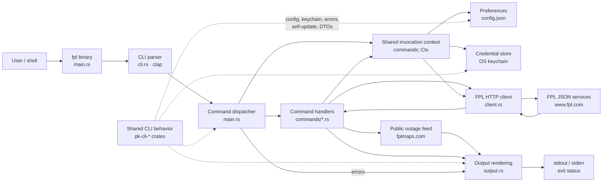
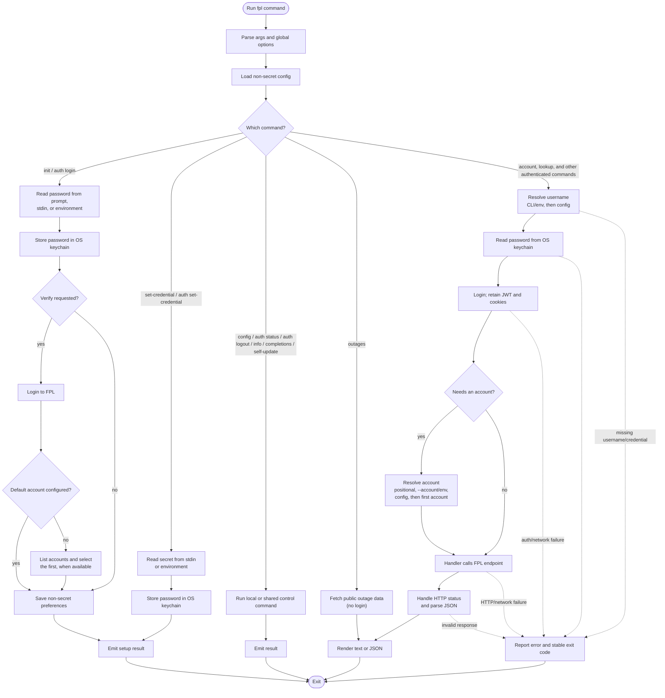

# Architecture and command flow

`fpl` is a single-binary CLI. Command handlers use shared CLI-family crates for
common behavior, while `client.rs` owns the FPL HTTP session and endpoint
operations. The diagrams below show the main runtime components and the
decision path for a command.

## Architecture

Resource handlers keep domain-specific orchestration. `Ctx` resolves the
username, opens authenticated sessions, and chooses the account; the client
handles login, cookies, JWT headers, and HTTP responses. `output.rs` renders
text or JSON, while errors are reported with the CLI's stable exit-code
contract.

## Command flow

The exact FPL login endpoints, session behavior, and resource mappings are
documented in [api.md](./api.md).

`lookup cities` and `lookup zips` use public FPL reference endpoints but still
open a session through the current command handler. `auth logout` makes a
best-effort server-side logout when a session can be opened; with `--forget`, it
skips provider login and clears the local credential and config directly.
